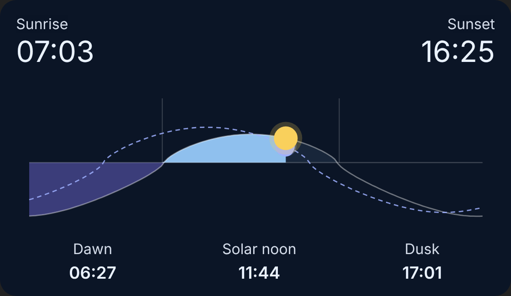
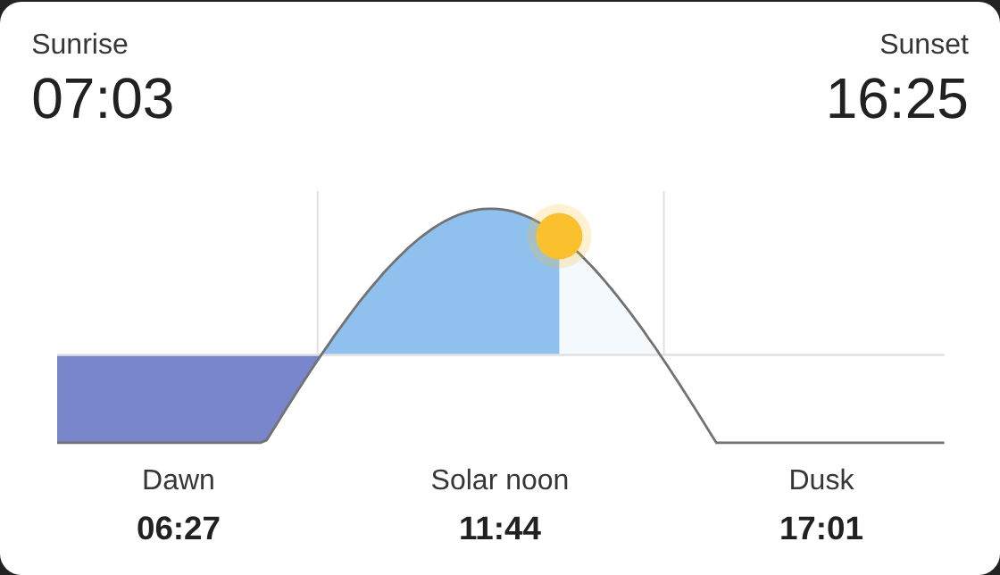
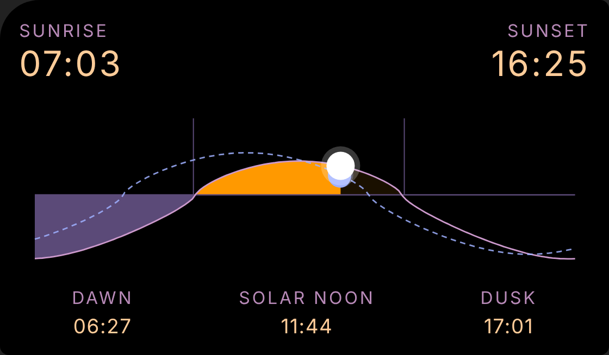
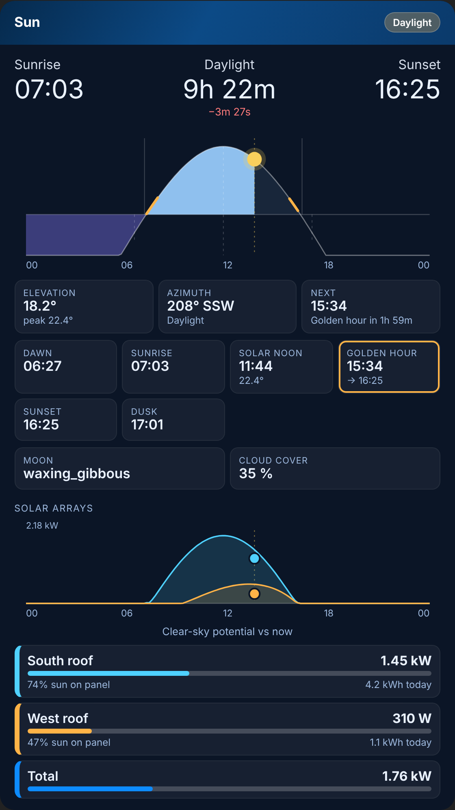
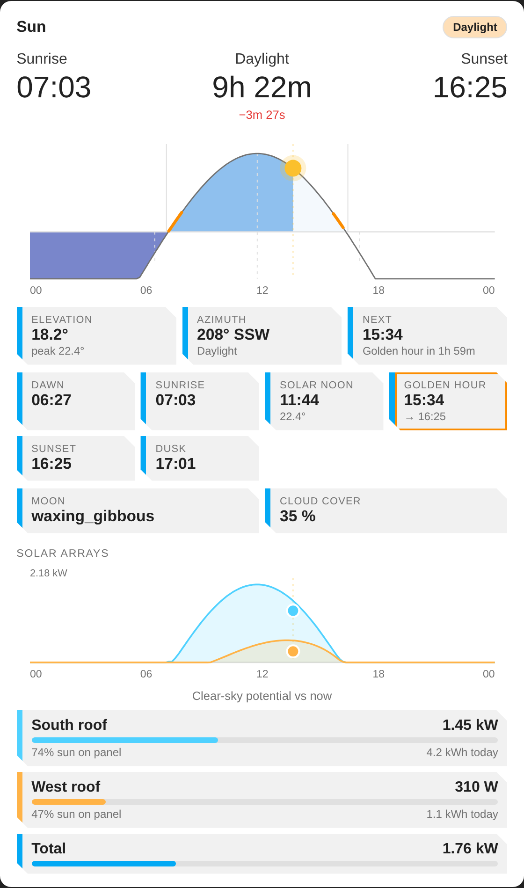
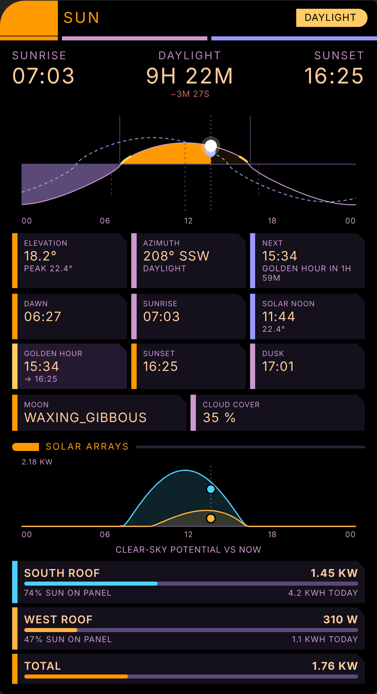

<p align="center"></p>

# Nevvyn Cards

Three Lovelace cards for Home Assistant in one install, each in three looks: **dark**, **light** and **LCARS**.

| Card | Type | What it does |
|---|---|---|
| Control panel | `custom:control-panel-card` | A tidy settings list: toggles, sliders, selects, times, buttons and read-only values, each with a short label and a "?" for the longer description. |
| Victron ESS | `custom:victron-ess-card` | Animated power flow and controls for a Victron ESS system. |
| Sun | `custom:sun-day-card` | Sunrise, sunset, dawn, dusk and a live sun position on a day curve. The advanced variant adds daylight length, golden hour and your solar arrays' potential against actual output. |

Requires **Home Assistant 2026.11 or newer** (Marketplace). HACS also works on older versions.

## Install

### Marketplace (HA 2026.11+)

1. Open the Marketplace, choose the menu, **Custom repositories**.
2. Add `https://github.com/NevvynPieEater/nevvyn-cards` as type **Dashboard**.
3. Install **Nevvyn Cards**, then refresh the browser.

The Marketplace puts the files in `/config/www/community/nevvyn-cards/` and registers the resource
`/local/community/nevvyn-cards/nevvyn-cards.js` (module) for you.

### HACS (older versions)

Same custom repository, category **Dashboard**.

### Manual

Copy `dist/nevvyn-cards.js` to `/config/www/community/nevvyn-cards/`, then add the resource
`/local/community/nevvyn-cards/nevvyn-cards.js?v=1.1.0` as a **JavaScript Module**. Change the `?v=` value each time you replace the file so browsers fetch the new copy.

## Updates and caching

All three cards live in one file, `nevvyn-cards.js`. The Marketplace puts a version in that file's resource URL (`?v=...`), so an update makes browsers fetch the new copy straight away, with no cache clearing. The sources are in `src/`; run `node scripts/build.mjs` to rebuild the bundle.

## Migrating from the manual files

1. Move the old `/config/www/community/nevvyn-cards` folder (and any old `victron-card` folders) aside before installing.
2. In Settings, Dashboards, Resources, remove the old per-card resources and the inline "ess-cards loader" resource.
3. Install through the Marketplace and refresh the browser.

## Sun card

Simple variant:

```yaml
type: custom:sun-day-card
```

Advanced variant with solar arrays:

```yaml
type: custom:sun-day-card
variant: advanced
style: dark            # dark | light | lcars
arrays:
  - name: North roof
    entity: sensor.north_roof_power      # live output (W)
    energy_entity: sensor.north_roof_energy_today
    peak_w: 4000
    azimuth: 0           # 0 = north, 180 = south
    tilt: 25
    color: "#f2a43a"
```

The curve is the whole day and night on one scale, so a higher sun or moon draws taller. Everything is computed in the browser from your Home Assistant location and time zone. If `sun.sun` exists, its elevation and azimuth drive the live sun marker.

### Layout and styling options

| Option | Meaning |
|---|---|
| `variant` | `simple` (default) or `advanced` |
| `style` | `dark`, `light`, `lcars` |
| `font_scale` | Overall text size multiplier, 0.5 to 3 |
| `chart_height` | Chart height in px, 80 to 800 |
| `arrays_chart_height` | Height of the arrays chart (advanced) |
| `sun_size` | Sun marker radius in px, 4 to 40 |
| `weather_entity` | A `weather.*` entity: clouds, rain, snow, fog or lightning are drawn over the sun and moon |
| `cloud_entity` | Optional sensor with cloud cover in %, overrides the weather entity's cloud coverage |
| `weather` | `true` (default), `false`, or an on/off entity such as `input_boolean.sun_weather` to switch the effects live |
| `moon` | `false` hides the dashed moon track and phase-shaded moon (on by default) |
| `fit` | `true` stretches the chart to fill the card's grid cell |
| `show` | `header`, `times`, `events`, `chart`: set any to `false` to hide it |
| `sections` | `stats`, `timeline`, `arrays`, `tiles` (advanced) |
| `colors` | `background`, `text`, `text_secondary`, `surface`, `line`, `day`, `night`, `curve`, `sun`, `moon`, `cloud`, `rain`, `gold`, `accent` |
| `time_format` | `12` or `24` |
| `latitude`, `longitude`, `time_zone` | Override the Home Assistant location |

The card also reads `--sdc-*` CSS variables (for example `--sdc-day`, `--sdc-sun`), so a theme can restyle it. It resizes to its dashboard cell, down to three columns wide.

## Screenshots

| | Dark | Light | LCARS |
|---|---|---|---|
| Simple |  |  |  |
| Advanced |  |  |  |

## Releasing

Edit the files in `src/`, run `node scripts/build.mjs`, commit, then tag a version (`git tag v1.0.1 && git push --tags`). The release workflow attaches `dist/nevvyn-cards.js`, which is what the Marketplace installs.

## Support

[Buy me a coffee](https://buymeacoffee.com/nevvyn)
